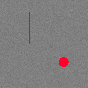

# Vision Inspect

An explainable, classical computer-vision baseline for comparing grayscale industrial surface images against a reference. Detects local defects despite a global brightness offset, groups connected regions, and evaluates against synthetic ground-truth masks.

## Quickstart

Python 3.10+ with NumPy >=1.26:

    python -m unittest discover -s tests -v
    python -m visioninspect.cli --demo --out inspection-output

This creates PNG images (reference, current, red defect overlay), a PGM mask, and a JSON report with defect bounding boxes and precision/recall/F1 on reproducible synthetic data.

For your own pair of ASCII P2 PGM files:

    python -m visioninspect.cli --reference clean.pgm --current inspected.pgm --out inspection-output

## Method

1. Compute the difference between aligned, same-size grayscale images.
2. Remove the median signed illumination offset.
3. Detect unusually large residuals using a minimum difference and robust median absolute deviation.
4. Filter small connected components (8-neighborhood).
5. Report image coordinates, pixel areas, peak difference and mask metrics.

## Limitations

This is **not a trained neural network**. It is a reproducible classical vision benchmark and potential baseline for learned models. Requires registered images with identical camera geometry. Large motion, shadows, textured changes, lens distortions, and real-world sensor conditions are not modeled. File inputs currently support ASCII P2 PGM; demos and masks export lossless PNG/PGM. Synthetic F1 does not establish real inspection accuracy.

## GitHub topics

computer-vision, defect-detection, industrial-inspection, anomaly-detection, image-processing, python

## License

MIT; see LICENSE.
